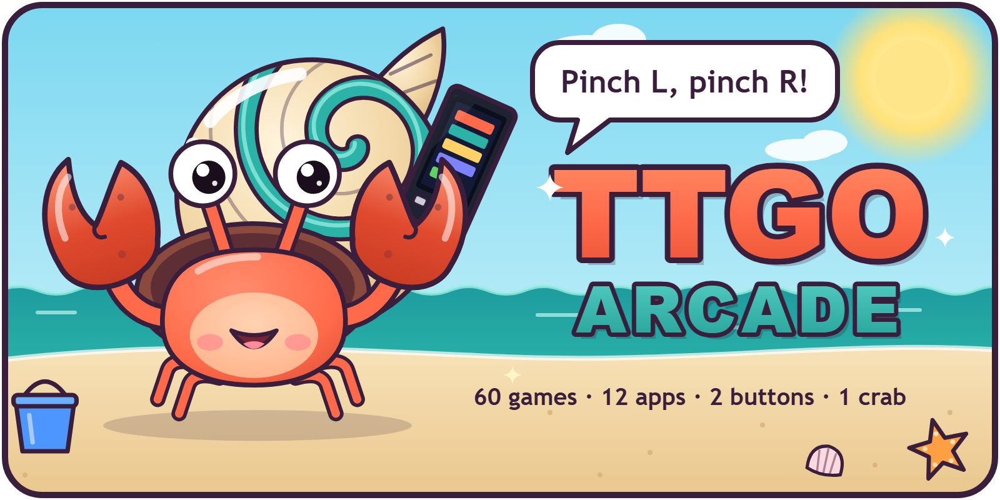
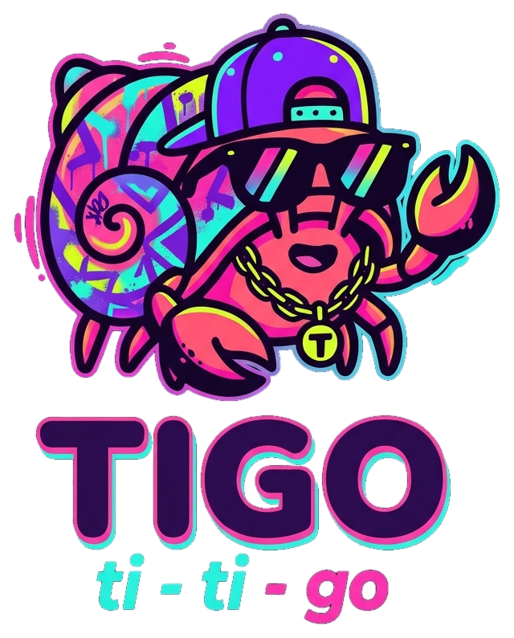
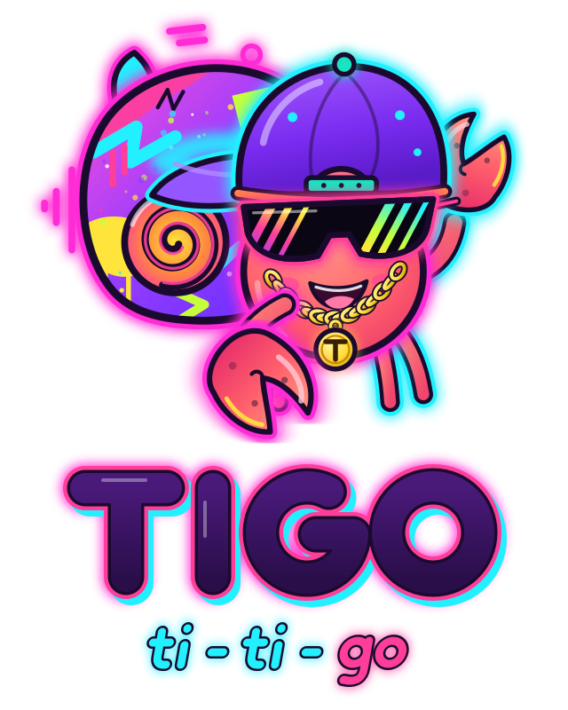
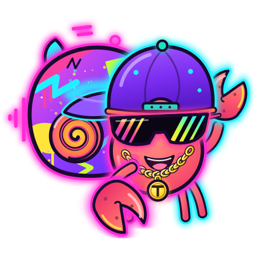

<p align="center">
  
</p>

<p align="center">
  <b>🦀 "Hi, I'm Tigo! Two claws, two buttons, 60 games. Pinch L, pinch R, let's play!"</b>
</p>

# 🎮 TTGO-Arcade

> Retro arcade game collection for the **LilyGO TTGO T-Display V1.1** (ESP32), hosted by **Tigo**, a cheeky hermit crab who lives in your screensaver.  
> Featuring **60 playable two-button games** (including the original **Fringe** and the two **Big Games**, Abyx and Crypt), **12 pocket apps**, a launcher with alphabetical Games and Apps lists, two themes (**Original** and **Neon**), automatic updates from GitHub, a Tamagotchi-style screensaver, a PIN lock, a WiFi clock, a Bluetooth remote for your phone, a companion web page, crash reports, persistent high scores, and a modular single-file architecture for makers.

<p align="center">
  <a href="https://buymeacoffee.com/zcnxsnw3vw"></a><br>
  <sub>Enjoying TTGO-Arcade? <a href="https://buymeacoffee.com/zcnxsnw3vw">Chip in to Tigo's shell fund</a> ☕🐚</sub>
</p>

---

## ✨ Features

- **60 Arcade, Action, Puzzle & Retro Games** — All designed specifically for a **135 × 240 portrait** IPS screen and **2 physical buttons**. The two biggest (**Abyx**, **Crypt**) come as a downloadable **Big Games cartridge**.
- **Launcher** — The boot screen lists **Games**, **Apps**, **Settings** and **Sleep**; Games and Apps open alphabetical lists, so every game is easy to find.
- **12 Pocket Apps** — **Breathe** (guided breathing), **Clock** (NTP over WiFi, time zones, digital / analog), **Comp.** (QR code to the companion page), **Dice** (dice, coin, D20, 1-100, yes/no), **Minute** (countdown with flashing alarm), **Morse** keyer/decoder, **Remote** (Bluetooth camera shutter, music and slides for iPhone & Android), **Support** (buy Tigo a coffee), **Tally** two-player counter, **Tigo** (feed, play with and clean the mascot), **Timer** (stopwatch with laps) and **Torch** (White, Warm, Red, SOS, Strobe).
- **Two Themes** — **Original** (the default) and **Neon**: a glowing purple-black UI with neon pink / cyan / lime outlines, and a neon Tigo with a backwards snapback, sunglasses and a gold chain.
- **Automatic Updates** — The launcher checks GitHub once an hour and installs a new build from *Settings → Updates*; developers can also push a build from the PC with *Settings → OTA update*. Your scores and settings stay put.
- **WiFi on demand** — WiFi only connects while something needs it (update check, clock sync, the WiFi / OTA / Updates screens, cartridge downloads) and switches fully off ~20 s later, saving battery and memory.
- **Tigo's Screensaver** — An animated beach where Tigo wanders, talks in speech bubbles, eats, naps and pinches your battery badge.
- **PIN Lock** — Optional 4-8 press L/R combination (e.g. `LLRL`), off by default.
- **Bluetooth** — A phone remote (no app needed) and a **Companion web page** to message Tigo, send treats, share your WiFi password, sync the clock and install the Big Games.
- **Smooth Animated Lists** — 60 fps scrolling with live animated game icons, mini battery/USB status badge, fast scroll down on `Hold L` and scroll up on `Hold L + R`.
- **Persistent Saves (NVS)** — Remembers high scores, the last category and item you opened, theme, brightness, screensaver and sleep timers, PIN, Tigo, WiFi and Bluetooth state, and USB logging across power-offs.
- **Power & Diagnostics** — 5 brightness levels, short or long idle timers (`5s` up to `10m`), deep sleep with single-button wake, battery voltage curve, and crash reports (faulting address and backtrace, shown as a QR code).
- **Easy to Extend** — Add a new game with one `src/<game>.cpp` file and two one-line registrations.

---

## 🦀 Meet Tigo

> 🦀 *"Battery tastes like 3.7 V."*

**Tigo** is the mascot of TTGO-Arcade (his name comes from "**Ti-Ti-Go**"). He is a coral-red hermit crab with a cream spiral conch on his back, two big eyes on stalks and **two big claws, one for each button**: press **L** or **R** and he snaps that claw. Curious, cheeky, playful and a little bit dramatic, he loves pinching things (especially the battery icon), collects shells and lives on a beach, by day or by night.

**His screensaver life** — when you leave the board alone, Tigo takes over the screen:

- 🏖️ He **wanders** along the beach, looks around and blinks.
- 💬 He **talks** in little speech bubbles ("Pinch L, pinch R!", "Is that a high score?").
- 🍤 He **eats** snacks, then **poops and buries it** in the sand like a proper gentlecrab.
- 😴 He **naps** in his shell when he gets sleepy.
- 🔋 He **plays with the battery and WiFi badges**: pinching the battery is his favourite hobby.
- 📱 He **reads messages sent from your phone** (see the Companion page) and munches the treats you send.
- 🐚 He shows off his **shells**: new ones unlock as you set high scores.

Press any button to wake the board from the screensaver (then the PIN lock if it is on, then the launcher).

---

---

## 🌈 Two Tigos: Original & Neon

> 🦀 *"Same crab. Better sunglasses."*

<table align="center">
  <tr>
    <td align="center" width="50%"><br><b>Original</b> <sub>(default)</sub></td>
    <td align="center" width="50%"><br><b>Neon</b></td>
  </tr>
</table>

Pick the look in **Settings → Theme**:

- **Original** (default) — the classic look: Tigo's sunny beach, clean outlined boxes, the colours you know.
- **Neon** — a deep purple-black background with glowing neon pink, cyan and lime outlines and accents across the launcher, the lists and the settings, and **Neon Tigo**: the same hermit crab, now wearing a purple snapback backwards (with a neon-teal button), black sunglasses with rainbow neon reflections, a gold chain with a round **T** medallion, and a graffiti-sprayed neon shell full of tags and drips.

The choice is saved and survives sleep and power-off. Neon Tigo artwork: `assets/tigo-neon-logo.svg` (with the *TIGO / ti - ti - go* lettering), `assets/tigo-neon.svg` (mascot only), and transparent PNG cut-outs of the original painting (`assets/tigo-neon-cutout.png`, `assets/tigo-neon-mascot.png`).

<p align="center">
  
</p>

---

## 🕹️ Controls Overview

> 🦀 *"Left claw, right claw. That's the whole keyboard. Easy!"*

The board has two buttons:
- **L** — `GPIO0` (also the `BOOT` button)
- **R** — `GPIO35` (also wakes the board from deep sleep)

### 🚀 Launcher
The boot screen is a launcher with four entries:

| Entry | Opens |
|---|---|
| **Games** | All 60 games, in alphabetical order (`2048` and `21` first); the Big Games (Abyx, Crypt) show greyed with **Download** until their cartridge is installed |
| **Apps** | The 12 pocket apps, in alphabetical order |
| **Settings** | Brightness, theme, timers, PIN, WiFi, Updates, OTA, Bluetooth, Crash report... |
| **Sleep** | Deep sleep right away (press **R** to wake) |

The launcher remembers the last category and item you opened.

**In every list** (launcher, Games, Apps, Settings, Reset scores, WiFi, WiFi networks, Updates): `Tap L` next · `Hold L` scroll down fast · **`Hold L + R` scroll up** (repeats while held) · `Tap R` open · `Hold R` back to the launcher (Games / Apps lists).

**Crash report** (Settings): if the board ever crashes it keeps the faulting address and backtrace; the report shows as a QR code to scan and send, and each CI build keeps its `firmware.elf` (artifact `elf-<build>`) to decode it.

### Universal Navigation
- **Launcher**: `Tap L` next entry · `Tap R` open
- **Games / Apps lists**: `Tap L` next · `Hold L` fast scroll · `Hold L + R` scroll up · `Tap R` open · `Hold R` back to the launcher. The first row of each list is **Back**.
- **Title Screen**: press any button to start
- **Game Over**: `L` menu (back to the Games list) · `R` play again
- **Apps**: `Hold L` goes back to the Apps list (Torch: `Tap R`)
- When a game or app ends you return to the list it came from, with it still selected.
- **Screensaver**: any button wakes it

---

## 🎯 Games (60)

> 🦀 *"Is that a high score? Beat it and I unlock a new shell!"*

Sorted alphabetically, as in the **Games** list on the device.

| Game | Type | Controls | Goal |
|---|---|---|---|
| **2048** | Puzzle | `Tap L / R` up/right · `Hold L / R` left/down | Merge matching tiles to reach 2048 and beyond |
| **21** | Puzzle | `Tap L` hit · `Tap R` stand / next hand | Arcade Blackjack; reach the highest chip stack |
| **Abyx** 🎮 | Big Game | `Hold L / R` walk · `L + R` jump (hold = higher) · auto-fire · `Hold L + R` 1 s still = map (keep holding: save & quit) | Metroidvania starring Tigo shooting shrimps: 28 rooms, 5 biomes, 5 guardians, powers (bubble jump, Jumbo claw, wall cling, jet dash, heat shell), hidden shells, save clams; portrait or landscape; it saves and sleeps when left idle |
| **Bowl** | Skill | `Tap L / R` set spot, then aim · `Hold L / R` hook | 10-pin bowling, real scoring with strikes & spares (300 max) |
| **Bricks** | Arcade | `Hold L / R` move paddle | Breakout: clear the wall, 3 lives, faster each level |
| **Bumper** | Arcade | `Hold L / R` steer · `L + R` turbo ram | Knock AI bots out of the circular sumo arena |
| **Catch** | Skill | `Hold L / R` move basket | Catch coins & gems, avoid red bombs; 3 lives |
| **Cave** | Runner | `Hold L` or `Hold R` thrust up | Fly through a narrowing cave and dodge rock pillars |
| **Chute** | Runner | `Hold L / R` steer · `L + R` open chute (below 350 m) | Skydive through rings, dodge birds, land on the pad |
| **Climb** | Skill | `Tap L / R` chop left/right | Climb fast without hitting branches or timing out |
| **Code** | Puzzle | `Tap L` cycle color · `Hold L` previous peg · `Tap R` next peg / submit | Crack the hidden 4-peg color code from the clues |
| **Columns** | Puzzle | `Tap L / R` move · `Hold L` cycle gems · `Hold R` fast drop | Match 3+ gems horizontally, vertically, or diagonally |
| **Crossy** | Runner | `Tap L / R` forward · `Hold L / R` sideways · `L + R` back | Cross roads and rivers; keep moving before the eagle comes |
| **Crypt** 🎮 | Big Game | `Hold L / R` turn · `Hold L + R` swim forward · `Tap L / R` cast · `Tap L + R` map | Original first-person raycasting crawl through a sunken crypt: 10 depths, keys and doors, foes and a boss; portrait or landscape |
| **Darts** | Skill | `Tap L / R` stop the aim (left-right sweep, then up-down) to throw | Pub darts: 8 rounds of 3 darts on a real board (doubles, triples, bull 50); a slight hand wobble keeps it honest; 180 = celebration |
| **Dino** | Runner | `Tap R` jump · `Hold L` duck / fast-fall | Leap cacti and duck under birds |
| **Dodge** | Arcade | `Hold L / R` move | Survive changing bullet patterns; skim bullets for graze points; one hit |
| **Doodle** | Runner | `Hold L / R` steer left/right | Bounce upward on platforms; cyan moves, yellow boosts |
| **Drop 4** | Puzzle | `Tap L` next column · `Tap R` drop disc | Connect four vs the CPU; keep your win streak going |
| **Duet** | Runner | `Hold L / R` spin orbit CCW / CW | Thread both orbiting spheres past falling blocks |
| **Falldown** | Runner | `Hold L / R` roll left/right | Drop through gaps before rising floors crush you |
| **Fish** | Skill | `Hold L / R` move boat · `L + R` reel in | 60 s of fishing: deep fish pay more, jellyfish steal, sharks cut the line |
| **Flappy** | Runner | `Tap L` or `Tap R` flap | Fly through pipe gaps; ramps up after ~30 points |
| **Fringe** | ✨ Original | `Tap L / R` send a ring from the left / right corner · `Hold L + R` cancel rings | Where a left ring crosses a right ring, a spark climbs the screen; the time gap between your two taps is the aim (L first = spark to the right). Catch drifting motes (chains multiply, 3 on one spark = +1 life), avoid red mines; a fading mote costs a life |
| **Frog** | Runner | `Tap L / R` hop forward · `Hold L / R` hop left/right | Cross traffic, ride logs, fill all 5 lily-pad homes; 3 lives |
| **Golf** | Skill | `Hold L / R` aim · `Hold & release L + R` putt | Sink holes before running out of shots (+3 shots/hole) |
| **Gravity** | Runner | `Tap L / R` fall to the left/right wall | Flip between walls to dodge spikes and saws; gems +10 |
| **Hi-Lo** | Puzzle | `Tap L` lower · `Tap R` higher | Guess the next card; streaks build up to a 5x multiplier; 3 lives |
| **Invaders** | Arcade | `Hold L / R` move cannon (auto-fire) | Clear alien waves behind 3 destructible shields; 3 lives |
| **Knife** | Skill | `Tap L / R` throw | Stick knives in a spinning log without hitting the others; boss every 5 stages |
| **Lights** | Puzzle | `Tap L` next cell · `Hold L` next row · `Tap R` toggle | Lights Out 5×5: switch every light off within the move limit |
| **Lunar** | Runner | `Hold L / R` push left/right · `L + R` main thrust | Land softly on the flat green pad before fuel runs out |
| **Math** | Skill | `Tap L` false · `Tap R` true | Judge equations before the timer bar empties; 3 lives |
| **Maze** | Arcade | `Tap L` left / up · `Tap R` right / down (the turn waits for the next opening, shown by an arrow) · `Hold L / R` U-turn | Eat every dot while dodging the ghosts; power pellets let you eat them; 3 lives |
| **Memory** | Puzzle | `Tap L` next card · `Tap R` flip card | Match all 8 pairs within limited tries |
| **Meteors** | Arcade | `Hold L / R` rotate · `L + R` thrust (auto-fire) | Blast splitting asteroids in wrap-around space; 3 lives |
| **Mines** | Puzzle | `Tap L` cell · `Hold L` row · `Tap R` reveal · `Hold R` flag | Clear minefields without hitting a mine |
| **Missile** | Arcade | `Hold L / R` sweep turret (auto-fires flak) | Intercept incoming missiles to protect 3 cities |
| **Pinball** | Arcade | `Hold L / R` flippers · `Hold & release R` launch | Hit bumpers, drop targets & top lanes (up to 5x); 3 balls |
| **Plinko** | Skill | `Tap L / R` drop ball · `Hold L / R` nudge balls | 12 balls through a peg board; the 100 slot gives a free ball |
| **Pong 2P** | Arcade | `Tap L` P1 flip dir · `Tap R` P2 flip dir | Local 2-player Pong on one board (first to 5; best = max rally) |
| **Pool** | Skill | `Hold L / R` aim · `Tap L / R` fine aim · `Hold L + R` power, release to shoot · ball in hand: `L / R` slide, `L + R` place · keep `L + R` held ~5 s = *Quit game?* · title: `Tap L` 1/2 players | 1 player: clear the table in as few shots as you can; 2 players: 8-ball vs a friend (taking turns) or vs the CPU (Easy / Normal / Hard) |
| **Pop** | Puzzle | `Tap L` next tile · `Hold L` next row · `Tap R` pop group | Pop groups of 2+ same tiles; bigger groups score much more |
| **Race** | Runner | `Hold L / R` steer | Dodge traffic on a winding road; grass slows you down |
| **Reversi** | Puzzle | `Tap L` next move · `Hold L` previous · `Tap R` place | Othello-style vs the CPU; score = your discs (+30 for a win) |
| **Rhythm** | Skill | `Tap L / R` hit left/right beat | Hit falling notes on the target ring (up to 4x combo) |
| **River** | Arcade | `Hold L / R` steer · `L + R` boost (auto-fire) | Shoot choppers & ships; fly over the pink `F` fuel tanks to refuel (don't shoot them) |
| **Shooter** | Arcade | `Hold L / R` fly (auto-fire) | Destroy saucers and cruisers in growing waves; 3 lives |
| **Simon** | Puzzle | `Tap L / R` cyan / magenta pad | Watch and repeat the growing color sequence |
| **Ski** | Runner | `Hold L / R` carve left/right | Dodge trees and rocks; pass flag gates for +50 |
| **Slots** | Puzzle | `Tap L` bet · `Tap R` spin / stop reel · `Hold L` cash out | 3-reel fruit machine from 100 credits; best = peak credits |
| **Snake** | Arcade | `Tap L / R` turn left/right (relative) | Eat food, avoid walls and yourself |
| **Stack** | Skill | `Tap L` or `Tap R` drop block | Stack cleanly; 3 perfect drops in a row widen the block |
| **Sub** | Arcade | `Hold L` dive · `Hold R` rise · `L + R` torpedo | Grab sea-floor chests, sink sharks & mines, surface for oxygen; 3 hulls |
| **Swing** | Runner | `Hold L / R` grapple (rope reels in) · release to fly | Swing from anchor to anchor; don't fall or get left behind |
| **Tank** | Arcade | `Hold L / R` aim barrel · `Hold L + R` charge, release to fire | Artillery duel vs a CPU tank over hills and wind; 3 HP each |
| **Tennis** | Arcade | `Hold L / R` move | Score as many points as you can before the CPU reaches 5; racket edges give sharp angles and every point makes the CPU sharper |
| **Tetris** | Puzzle | `Tap L / R` move · `Hold L` rotate · `Hold R` soft drop · `L + R` hard drop | Clear lines; speeds up every 10 lines |
| **Tron** | Arcade | `Tap L / R` turn 90° left/right | Light cycles: trap the AI in your trail; each round is faster |
| **Whack** | Skill | `Tap L / R` whack left/right burrow | Hit moles (+10 / +30), skip red bombs; 3 lives |

*Fringe — original game by Jérémy Noverraz, 2026.*

---

## 🛠️ Pocket Apps (12)

> 🦀 *"Not everything is a game. Some things are a game with a clock."*

Sorted alphabetically, as in the **Apps** list on the device.

| App | Controls | Description |
|---|---|---|
| **Breathe** | `Tap L` pattern · `Tap R` start / pause · `Hold L` back | Guided breathing (Box 4-4-4-4, Relax 4-7-8, Calm 5-5) with an animated circle |
| **Clock** | `Tap L` next time zone · `Tap R` digital / analog · `Hold L` back | Time from NTP over WiFi (connects by itself when WiFi is allowed) or from your phone via Bluetooth; default zone Europe/Zurich |
| **Comp.** | `Tap R` QR code / address · `Hold L` back | Companion: QR code to the companion web page and the Bluetooth link state (Bluetooth stays on while it is open); shows the progress when the phone installs the Big Games |
| **Dice** | `Tap L` mode · `Tap R` roll · `Hold L` back | 1–5 dice with total, coin flip, D20, 1–100 or yes/no (mode is remembered) |
| **Minute** | `Tap L` preset / +1 min / reset · `Tap R` start / pause · `Hold L` back | Countdown (1–60 min presets); the screen flashes at full brightness when time is up |
| **Morse** | `Tap L` dot · `Tap R` dash · `Hold R` delete · `Hold L` back | Morse keyer: decodes what you tap, with a live cheat sheet of matching letters |
| **Remote** | `Hold L + R` switch mode (Camera / Music / Slides) · `Hold L` back | Bluetooth remote for iPhone & Android, no app (see below) |
| **Support** | `Tap L` Tigo cheers · `Tap R` big QR · `Hold L` back | QR code to [Buy Me a Coffee](https://buymeacoffee.com/zcnxsnw3vw); TTGO-Arcade is free, donations are optional |
| **Tally** | `Tap L` A +1 · `Tap R` B +1 · `Hold R` undo · `Hold L + R` reset · `Hold L` back | Two-player score counter, saved across sleep and power-off |
| **Tigo** | `Tap L` feed · `Tap R` play · `Hold R` clean · `Hold L` back | Look after Tigo: hunger, fun and clean bars; shells unlock from your high scores |
| **Timer** | `Tap R` start/stop · `Tap L` lap/reset · `Hold L` back | Precision stopwatch with up to 5 lap splits |
| **Torch** | `Tap L` cycle mode · `Tap R` back | Full-screen flashlight at max brightness (`White`, `Warm`, `Red`, `SOS`, `Strobe`) |

### 🐚 Tigo app
Tigo's own little Tamagotchi corner. `Tap L` **feeds** him, `Tap R` **plays** with him, `Hold R` **cleans** up after him, `Hold L` goes back to the Apps list. Three bars show his **hunger**, **fun** and **clean** levels; a happy Tigo is a chatty Tigo in the screensaver. Your **high scores unlock new shells** for his collection.

### 🕰️ Clock app
A desk clock with **digital** and **analog** faces (`Tap R` switches). The time comes from **NTP over WiFi** (with WiFi allowed in Settings the board connects by itself to sync, at boot when the time is unknown and then every 6 h, and switches WiFi off again), or from **your phone** through the Companion page over Bluetooth. `Tap L` steps through **time zones** (default **Europe/Zurich**, `CET-1CEST,M3.5.0,M10.5.0/3`, with automatic daylight saving). `Hold L` returns to the Apps list.

---

---

## 📶 Bluetooth

> 🦀 *"I can pinch your phone's buttons too. From here."*

Switch **Bluetooth** on in Settings. The board shows up as **`TTGO-Arcade`**.

### Remote app (Bluetooth HID, no app needed)
Pair **`TTGO-Arcade`** from your phone's Bluetooth settings (works on **iPhone and Android**, no app to install), then open **Apps → Remote**. `Hold L + R` switches mode, `Hold L` goes back to the Apps list.

| Mode | Controls | Use it for |
|---|---|---|
| **Camera** | `Tap L` or `Tap R` shutter (volume up) | Group photos and selfies from a distance |
| **Music** | `Tap L` previous · `Tap R` next · `Hold R` play / pause | Your playlist, from across the room |
| **Slides** | `Tap L` previous · `Tap R` next | Presentations |

### Companion web page
**👉 [iyotee.github.io/TTGO-Arcade/companion.html](https://iyotee.github.io/TTGO-Arcade/companion.html)**

Open it in **Chrome or Edge on Android or on a desktop** (it uses Web Bluetooth, so it does **not** work on iPhone), press *Connect* and pick `TTGO-Arcade`. From the page you can:

- 💬 **send Tigo a message**, shown in his speech bubble on the screensaver;
- 🍤 **send treats** (he eats them in the screensaver);
- 📶 **send a WiFi name and password**, so you never type on the board;
- 🕰️ **sync the clock** from your phone (no WiFi needed);
- 🔋 **see the battery and WiFi status** of the board;
- 🎮 **install the Big Games cartridge** over Bluetooth (keep the board's **Comp.** app open).

> **Note for forks:** the page lives in `docs/companion.html` and is published on **GitHub Pages** by the CI ([build.yml](.github/workflows/build.yml)) together with the firmware. Enable it once under *Settings → Pages → Source = GitHub Actions*.

---

---

## ⚙️ Settings & Sleep

> 🦀 *"Settings? I only need one: more snacks."*

- **Launcher**: Shows a live battery/USB badge top-left (plus a WiFi badge only while WiFi is actually connected, and an arrow badge when an update is available) and remembers the last category and item.
- **Settings** (scrolling list):

| Row | Values | What it does |
|---|---|---|
| **Brightness** | 5 levels | PWM backlight level |
| **Theme** | `Original` / `Neon` (default `Original`) | UI look and Tigo's outfit (see *Two Tigos*) |
| **Screensaver** | `Off`, `5s`, `8s`, `10s`, `15s`, `20s`, `30s`, `1m`, `2m`, `5m` (default `15s`) | Idle time before Tigo's screensaver |
| **Sleep** | `5s`, `8s`, `10s`, `15s`, `20s`, `30s`, `1m`, `2m`, `5m`, `10m`, `Never` (default `1m`) | Time spent in the screensaver before deep sleep, or idle time before deep sleep when the screensaver is `Off` |
| **PIN lock** | `Off` / `On` (default `Off`) | Ask for the PIN at boot, on wake from deep sleep and when leaving the screensaver |
| **Change PIN** | | Set a new 4-8 press combination |
| **WiFi >** | `On` / `Off` (`...` while connecting), submenu | `On` = WiFi **allowed** (it connects on demand); see below |
| **Updates >** | screen (`New` when a newer launcher is out) | **Check now**, **Install**, **Auto-check** `On` / `Off` (the hourly check), **Back** (see *Big Games cartridge & automatic updates*) |
| **OTA update >** | screen | Receive a firmware upload from the PC over WiFi (see *OTA updates*) |
| **Bluetooth** | `On` / `Off` (`Linked` while a phone is connected) | Remote app and Companion page |
| **USB log** | `On` / `Off` | Diagnostic serial logging (`115200` baud) |
| **Reset scores >** | submenu | Clear **All games** or any individual game's best score (with confirmation) |
| **Crash report >** | `none` / `!` | The last crash as a QR code (`Tap R` QR / text, `Tap L` forget, `Hold L` back) |
| **Back to menu** | | Return to the launcher |

- **WiFi >**: **WiFi** `On` / `Off` (saved: whether WiFi is *allowed*), **Scan networks** (strongest first, lock = password), **WPS connect** (press the WPS button on your router within 2 min: no typing), **Forget network**. Passwords are typed on a character wheel: `Tap L` next · `Hold L` previous · `Tap R` type · `Hold R` next group (`abc` / `ABC` / `123` / `#+=` / `OK DEL ESC`), or sent from the Companion page. **WiFi runs on demand**: it only connects for the hourly update check, the clock sync, the WiFi / OTA / Updates screens, cartridge downloads and credentials sent from the phone, then switches fully off about 20 s after the last user (this frees ~50 KB of memory for Bluetooth and HTTPS, and saves the battery). The WiFi badge shows in the launcher only while it is connected. `Off` means WiFi never starts.
- **Crash indicator**: an orange line at the bottom of Settings names the last crash (e.g. `! crash: Flappy b42`); open **Crash report** for the details.
- **Crash report**: the board keeps the faulting address (PC), the exception cause and a short backtrace across the reset. The report shows as a QR code to scan and send (or as text); each CI build keeps its `firmware.elf` (artifact `elf-<build>`, 90 days) to decode it.

### 😴 Screensaver & sleep timers
1. After the **Screensaver** idle time, Tigo's beach screensaver starts.
2. After the **Sleep** time spent in the screensaver, the board goes into **deep sleep** (backlight and battery ADC off). With the screensaver `Off`, **Sleep** is simply the idle time before deep sleep. `Never` keeps the board awake.
3. Games only do this from their title and game-over screens, except **Pool**, **Crypt** and **Abyx**, which also hand over to the screensaver (and then deep sleep) when left idle in play (Abyx saves first; Pool never while balls roll or during the CPU's turn).
4. Any button leaves the screensaver; press **R** (`GPIO35`) to wake from deep sleep. If the PIN lock is on, it asks for the PIN first, then you are back in the launcher.

### 🔒 PIN lock
> 🦀 *"LLRL? I won't tell anyone. Probably."*

- **Set it**: *Settings → Change PIN*, tap **L** / **R** 4 to 8 times (e.g. `LLRL`), **hold L + R** to confirm, then enter it again to confirm. Turn **PIN lock** `On` to use it (it is `Off` by default).
- **Unlock**: just type the combination; it is checked automatically once you reach its length.
- **Lockout**: after **5 wrong tries** you must wait **30 s** before trying again.
- **When**: at boot, on wake from deep sleep, and when leaving the screensaver.

---

---

## 🎮 Big Games cartridge & automatic updates

> 🦀 *"Some games are too big for my shell. I keep them in a second one!"*

The launcher holds the light games, the apps and the settings. The heavy games (**Abyx**, **Crypt**) live in a separate **Big Games cartridge** stored in the board's second app slot. Until it is installed they show greyed with **Download** in the Games list. Select one to see the download size, free space and battery, then get it:

- **over WiFi**: HTTPS from GitHub Pages, SHA-256 checked (the screen connects WiFi by itself, as long as WiFi is allowed and a network is saved);
- **from your phone**: scan the QR code (Apps → Comp.) to open the [companion page](https://iyotee.github.io/TTGO-Arcade/companion.html), tap **Connect**, then **Install** (Chrome on Android / desktop).

Once installed the game shows **Ready**. Starting it reboots into the cartridge (about 2 s); leaving the game reboots back into the launcher. Scores and settings are shared. A reset, crash or sleep inside the cartridge always lands back in the launcher.

**Updates**: while WiFi is allowed, the launcher connects once an hour to check [fw/manifest.json](https://iyotee.github.io/TTGO-Arcade/fw/manifest.json), then lets WiFi switch off again (never during a game; turn **Auto-check** off in *Settings → Updates*, where **Check now** checks at once). A newer launcher shows an arrow badge, **Update available** and `New` on the Updates row; **Install** asks for confirmation and needs more than 30 % battery or USB power. A launcher update (or a PC upload through OTA update) uses the cartridge's slot, so the Big Games have to be downloaded again afterwards. Local builds are build 0 and never ask to update. Every push to `main` is built by GitHub Actions ([build.yml](.github/workflows/build.yml)) and published to GitHub Pages together with the companion page.

## 📡 OTA updates

> 🦀 *"New firmware, no cable? I'll catch it with my claws."*

1. On the board, allow WiFi and save a network (*Settings → WiFi*), then open **Settings → OTA update**: it connects by itself (and pauses Bluetooth while it is open). The screen shows the hostname `ttgo-arcade.local` and the board's IP address. Uploads are **only accepted while this screen is open**; leave it and OTA is off again.
2. On your computer, on the same network:

   ```sh
   pio run -e ota -t upload                          # uses ttgo-arcade.local
   pio run -e ota -t upload --upload-port 192.168.1.42   # or the IP shown on screen
   ```

3. The board shows the progress, then reboots into the new firmware.

Your **high scores and settings are kept**: the NVS partition stays at the same place (`0x9000`). An upload goes into the other app slot, so the Big Games cartridge has to be downloaded again afterwards. The first build that switches to the OTA flash layout has to be flashed **over USB once** (`pio run -t upload`); after that, OTA works.

---

## 🚀 Building & Flashing

> 🦀 *"Flash me gently: over USB, or over the air."*

Requires [PlatformIO](https://platformio.org/) (VS Code extension or `pio` CLI). Dependencies (`espressif32@6.9.0`, `TFT_eSPI@^2.5.43`, `NimBLE-Arduino@~1.4.3`, `QRCode@^0.0.1`) are fetched automatically on first build.

```sh
pio run                    # Compile the launcher firmware
pio run -e cartridge       # Compile the Big Games cartridge (installed from the launcher, never over USB)
pio run -t upload          # Compile and flash over USB
pio run -e ota -t upload   # Compile and flash over WiFi (open Settings > OTA update first)
pio device monitor         # Serial monitor (115200 baud, exception decoder)
```

> **Note:** All `TFT_eSPI` pin and driver flags live in `platformio.ini`, so no manual edits inside `.pio/libdeps/` are required.  
> If your display appears upside down, set `SCREEN_ROTATION` to `2` in `src/common.h` (this also swaps L/R button mapping).

> **Flash layout:** the firmware uses `board_build.partitions = min_spiffs.csv`: **two 1.9 MB app slots** (one runs, the other receives the OTA update) and a small SPIFFS. It replaces the old `huge_app.csv` (3 MB, no OTA). The NVS partition does not move, so your **high scores and settings are kept** when you upgrade from an older build; flash over USB once when coming from a `huge_app` build.

---

## 🧩 Project Structure

```text
├── platformio.ini        # Board, libraries, TFT_eSPI build flags, partitions (min_spiffs.csv); envs: ttgo-t-display (USB), cartridge, ota
├── README.md             # Project documentation
├── .github/workflows/
│   └── build.yml         # CI: checks the docs, builds both firmwares, publishes them + docs/ on GitHub Pages
├── tools/
│   └── check_docs.py     # Checks that README / docs / logo counts and tables match the code (run by the CI)
├── assets/               # Artwork (not flashed to the board)
│   ├── tigo-logo.svg/.png        # The header logo (Tigo on the beach)
│   ├── tigo.svg                  # Original Tigo
│   ├── tigo-neon-logo.svg/.png   # Neon Tigo + "TIGO / ti - ti - go" lettering
│   ├── tigo-neon.svg             # Neon Tigo, mascot only
│   ├── tigo-neon-cutout.png      # Neon Tigo painting, transparent cut-out (with lettering)
│   ├── tigo-neon-mascot.png      # Neon Tigo painting, transparent cut-out (crab only)
│   ├── tigo-neon-source.jpg      # The original neon Tigo painting
│   └── support-me-sticker.gif    # Support sticker
├── docs/                 # GitHub Pages
│   ├── index.html        # Home page (latest build from fw/manifest.json)
│   └── companion.html    # Web Bluetooth companion page (messages, treats, WiFi, clock, Big Games install)
└── src/
    ├── common.h          # Pin definitions, shared helpers, theme API, game declarations
    ├── main.cpp          # Launcher, Games / Apps lists (ITEMS[] table), badges, setup/loop
    ├── ui_common.cpp/.h  # Shared by both firmwares: globals, buttons, score / game-over screens, start-up
    ├── theme.cpp, themeui.h      # Original / Neon themes, themed boxes
    ├── power.cpp/.h      # PWM backlight, battery ADC curve, screensaver / sleep delays, deep sleep
    ├── diag.cpp          # USB logging & the last-crash line
    ├── crashrec.cpp/.h   # Crash forensics: PC, cause and backtrace kept across the reset
    ├── crashui.cpp       # Settings > Crash report (QR code / text)
    ├── settings.cpp      # Settings list, Reset scores submenu & confirmation
    ├── tigo.cpp/.h       # drawTigo(): the mascot in all his poses (and outfits), his needs and shells
    ├── saver.cpp         # Tigo's beach screensaver (messages and treats from the phone)
    ├── lockscr.cpp/.h    # PIN lock: set, unlock, lockout
    ├── clock.cpp/.h      # Time service: NTP sync (WiFi on demand), time zones
    ├── ble.cpp/.h        # Bluetooth: HID remote + companion page service (incl. cartridge install)
    ├── wifi.cpp          # WiFi on demand (wifiAcquire / wifiRelease): reconnect, scan, connect, WPS
    ├── wifiui.cpp        # WiFi screens: status, network list, password wheel, WPS
    ├── otaui.cpp         # Settings > OTA update (upload from the PC)
    ├── updates.cpp/.h    # Hourly manifest check, downloads, Settings > Updates
    ├── netcerts.h        # Root certificates for the HTTPS downloads
    ├── cart.cpp/.h       # Big Games cartridge: install into the other app slot, hand-over
    ├── cartui.cpp        # Cartridge screen (download / start Abyx and Crypt)
    ├── cartmain.cpp      # The cartridge firmware's entry point (env cartridge)
    ├── orient.h          # Portrait / landscape helper for the Big Games
    ├── abyx.cpp, abyx_*.h        # Abyx (cartridge)
    ├── crypt.cpp, crypt_*.h      # Crypt (cartridge)
    ├── breathe.cpp, clockapp.cpp, companionapp.cpp, dice.cpp, minute.cpp, morse.cpp,
    │   remote.cpp, support.cpp, tally.cpp, tigoapp.cpp, timer.cpp, torch.cpp   # The 12 apps
    └── <game>.cpp        # One self-contained namespace per game
```

**Adding a game:** create `src/<name>.cpp` with a `namespace <name>` exposing `begin()`, `update(now)` and `drawIcon(cx, cy, dim, t)` (copy the structure of `gravity.cpp` or `stack.cpp`), then add `DECLARE_GAME(<name>)` to `common.h` and a `GAME("Name", "<name>_hi", <name>)` line to `ITEMS[]` in `main.cpp`. The Games list sorts itself alphabetically, so the position in `ITEMS[]` does not matter. The high score is kept in NVS under `<name>_hi` (15 characters max). Then add its row to the **Games** table of this README (and bump the counts): the CI runs `python3 tools/check_docs.py` and fails when the docs don't match the code.

---

## 🔧 Troubleshooting

> 🦀 *"Something's wrong? Don't panic. I'll hide in my shell, you read this."*

- **Upload fails** (`No serial data received` / `serial noise`): Run `pio run -t upload` again (the CH9102 USB-serial chip occasionally needs a retry), or hold **L (BOOT)** while upload starts. Keep `upload_speed = 460800`.
- **Screen is black**: The board is in deep sleep — press **R** (`GPIO35`) to wake it.
- **Forgot your PIN**: Reflash the firmware after erasing the flash (`pio run -t erase`, then `pio run -t upload`); this also clears high scores and settings.
- **Clock shows no time**: Allow WiFi (*Settings → WiFi*, `On`) and save a network (the board connects by itself to sync), or sync the clock from the Companion page.
- **Phone can't find `TTGO-Arcade`**: Check that **Bluetooth** is `On` in Settings; on iPhone pair it from *Settings → Bluetooth*. If it was paired before a reflash, *forget* it on the phone and pair again.
- **Companion page won't connect**: Use Chrome or Edge on Android or desktop (Web Bluetooth is not available on iPhone).
- **OTA upload is refused or times out**: Open *Settings → OTA update* on the board first (uploads are only accepted while that screen is shown), check that WiFi is allowed and a network is saved (the screen connects by itself), and use the IP shown on screen if `ttgo-arcade.local` does not resolve (`pio run -e ota -t upload --upload-port <ip>`). The very first switch to the OTA flash layout must be flashed over USB.
- **Debugging**: Enable `Settings → USB log` and run `pio device monitor`.

---

---

## 🖥️ Hardware

- **Board**: [LilyGO TTGO T-Display V1.1](https://lilygo.cc/products/t-display)
  - ESP32 Xtensa dual-core LX6 @ 240 MHz (4 MB Flash)
  - 1.14" ST7789V IPS LCD (`135 × 240`, SPI, full color)
  - CH9102 USB-to-Serial
  - 2-pin 1.25 mm JST LiPo battery connector
- **Battery**: 3.7 V LiPo (e.g., `102540`)
- **3D Printable Case**: [Kivo Case for LilyGO T-Display](https://makerworld.com/en/models/3387545-kivo-case-lilygo-t-display-project?from=search#profileId-3855076)

---

---

## ☕ Support Tigo's shell fund

> 🦀 *"Every coffee buys me a shinier shell. And you more games."*

TTGO-Arcade is free and open. If it made you smile, you can support its development:

<p align="center">
  <a href="https://buymeacoffee.com/zcnxsnw3vw"></a><br>
  <a href="https://buymeacoffee.com/zcnxsnw3vw"><b>buymeacoffee.com/zcnxsnw3vw</b></a>
</p>

---

<p align="center">
  
  &nbsp;&nbsp;
  <br>
  <i>🦀 "Thanks for playing! Now go set a high score, I want a new shell." 🐚</i>
</p>
