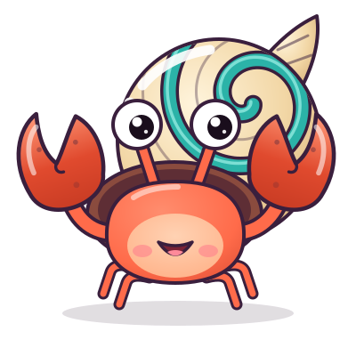

<p align="center">
  
</p>

<p align="center">
  <b>🦀 "Hi, I'm Tigo! Two claws, two buttons, 56 games. Pinch L, pinch R, let's play!"</b>
</p>

# 🎮 TTGO-Arcade

> Retro arcade game collection for the **LilyGO TTGO T-Display V1.1** (ESP32), hosted by **Tigo**, a cheeky hermit crab who lives in your screensaver.  
> Featuring **56 playable two-button games** (including the original **Fringe**), **10 pocket tools**, a Tamagotchi-style screensaver, a PIN lock, a WiFi clock, a Bluetooth remote for your phone, a lightweight animated UI, persistent high scores, and a modular single-file architecture for makers.

---

## ✨ Features

- **56 Arcade, Action, Puzzle & Retro Games** — All designed specifically for a **135 × 240 portrait** IPS screen and **2 physical buttons**.
- **10 Pocket Tools** — **Tigo** (feed, play with and clean the mascot), **Clock** (NTP over WiFi, time zones, digital / analog), **Remote** (Bluetooth camera shutter, music and slides for iPhone & Android), **Stopwatch** (with laps), **Flashlight** (White, Warm, Red, SOS, Strobe), **Dice** (dice, coin, D20, 1-100, yes/no), **Tally** two-player counter, **Countdown** timer with flashing alarm, **Morse** keyer/decoder and guided **Breathing**.
- **Tigo's Screensaver** — An animated beach where Tigo wanders, talks in speech bubbles, eats, naps and pinches your battery badge.
- **PIN Lock** — Optional 4-8 press L/R combination (e.g. `LLRL`), off by default.
- **Bluetooth** — A phone remote (no app needed) and a **Companion web page** to message Tigo, send treats, share your WiFi password and sync the clock.
- **Smooth Animated Menu** — 60 fps scrolling list with live animated game icons, mini battery/USB status badge, and fast scroll on `Hold L`.
- **Persistent Saves (NVS)** — Remembers high scores, last played game, brightness, screensaver and sleep timers, PIN, Tigo, WiFi and Bluetooth state, and USB logging across power-offs.
- **Power & Diagnostics** — 5 brightness levels, short or long idle timers (`5s` up to `10m`), deep sleep with single-button wake, battery voltage curve, and crash reporting.
- **Easy to Extend** — Add a new game with one `src/<game>.cpp` file and two one-line registrations.

---

## 🦀 Meet Tigo

> 🦀 *"Battery tastes like 3.7 V."*

**Tigo** is the mascot of TTGO-Arcade (his name comes from "**Ti-Ti-Go**"). He is a coral-red hermit crab with a cream spiral conch on his back, two big eyes on stalks and **two big claws, one for each button**: press **L** or **R** and he snaps that claw. Curious, cheeky, playful and a little bit dramatic, he loves pinching things (especially the battery icon), collects shells and lives on a beach, by day or by night.

**His screensaver life** — when you leave the board alone, Tigo takes over the screen:

- 🏖️ He **wanders** along the beach, looks around and blinks.
- 💬 He **talks** in little speech bubbles ("Pinch L, pinch R!", "Is that a high score?").
- 🍤 He **eats** snacks, then **poops and buries it** in the sand like a proper gentlecrab.
- 😴 He **naps** in his shell when he gets sleepy.
- 🔋 He **plays with the battery and WiFi badges**: pinching the battery is his favourite hobby.
- 📱 He **reads messages sent from your phone** (see the Companion page) and munches the treats you send.
- 🐚 He shows off his **shells**: new ones unlock as you set high scores.

Press any button to wake the board from the screensaver (then the PIN lock if it is on, then the menu).

---

## 🕹️ Controls Overview

> 🦀 *"Left claw, right claw. That's the whole keyboard. Easy!"*

The board has two buttons:
- **L** — `GPIO0` (also the `BOOT` button)
- **R** — `GPIO35` (also wakes the board from deep sleep)

### Universal Navigation
- **Menu**: `Tap L` next item · `Hold L` fast scroll · `Tap R` open / play
- **Title Screen**: press any button to start
- **Game Over**: `L` return to menu · `R` play again
- **Tools**: `Hold L` returns to the menu (Torch: `Tap R`)
- **Screensaver**: any button wakes it

---

## 🎯 Games (56)

> 🦀 *"Is that a high score? Beat it and I unlock a new shell!"*

### ✨ Original
| Game | Controls | Goal |
|---|---|---|
| **Fringe** | `Tap L / R` send a ring from the left / right corner · `Hold L + R` cancel rings | Where a left ring crosses a right ring, a spark climbs the screen; the time gap between your two taps is the aim (L first = spark to the right). Catch drifting motes (chains multiply, 3 on one spark = +1 life), avoid red mines; a fading mote costs a life |

*Fringe — original game by Jérémy Noverraz, 2026.*

### Arcade & Action
| Game | Controls | Goal |
|---|---|---|
| **Pinball** | `Hold L / R` flippers · `Hold & release R` launch | Hit bumpers, drop targets & top lanes (up to 5x); 3 balls |
| **Bricks** | `Hold L / R` move paddle | Breakout: clear the wall, 3 lives, faster each level |
| **Tennis** | `Hold L / R` move | Beat the CPU; paddle edges give sharp angles (first to 5) |
| **Pong 2P** | `Tap L` P1 flip dir · `Tap R` P2 flip dir | Local 2-player Pong on one board (first to 5; best = max rally) |
| **Shooter** | `Hold L / R` fly (auto-fire) | Destroy saucers and cruisers in growing waves; 3 lives |
| **Invaders** | `Hold L / R` move cannon (auto-fire) | Clear alien waves behind 3 destructible shields; 3 lives |
| **Meteors** | `Hold L / R` rotate · `L + R` thrust (auto-fire) | Blast splitting asteroids in wrap-around space; 3 lives |
| **River** | `Hold L / R` steer · `L + R` boost (auto-fire) | Shoot choppers & ships; fly over `F` tanks to refuel |
| **Missile** | `Hold L / R` sweep turret (auto-fires flak) | Intercept incoming missiles to protect 3 cities |
| **Bumper** | `Hold L / R` steer · `L + R` turbo ram | Knock AI bots out of the circular sumo arena |
| **Maze** | `Tap L / R` turn left/right · `Hold L / R` U-turn | Eat all dots & power pellets, dodge ghosts; 3 lives |
| **Snake** | `Tap L / R` turn left/right (relative) | Eat food, avoid walls and yourself |
| **Tron** | `Tap L / R` turn 90° left/right | Light cycles: trap the AI in your trail; each round is faster |
| **Tank** | `Hold L / R` aim barrel · `Hold L + R` charge, release to fire | Artillery duel vs a CPU tank over hills and wind; 3 HP each |
| **Dodge** | `Hold L / R` move | Survive changing bullet patterns; skim bullets for graze points; one hit |
| **Sub** | `Hold L` dive · `Hold R` rise · `L + R` torpedo | Grab sea-floor chests, sink sharks & mines, surface for oxygen; 3 hulls |

### Endless Runners, Jumpers & Dodgers
| Game | Controls | Goal |
|---|---|---|
| **Flappy** | `Tap L` or `Tap R` flap | Fly through pipe gaps; ramps up after ~30 points |
| **Doodle** | `Hold L / R` steer left/right | Bounce upward on platforms; cyan moves, yellow boosts |
| **Falldown** | `Hold L / R` roll left/right | Drop through gaps before rising floors crush you |
| **Dino** | `Tap R` jump · `Hold L` duck / fast-fall | Leap cacti and duck under birds |
| **Cave** | `Hold L` or `Hold R` thrust up | Fly through a narrowing cave and dodge rock pillars |
| **Ski** | `Hold L / R` carve left/right | Dodge trees and rocks; pass flag gates for +50 |
| **Race** | `Hold L / R` steer | Dodge traffic on a winding road; grass slows you down |
| **Crossy** | `Tap L / R` forward · `Hold L / R` sideways · `L + R` back | Cross roads and rivers; keep moving before the eagle comes |
| **Duet** | `Hold L / R` spin orbit CCW / CW | Thread both orbiting spheres past falling blocks |
| **Lunar** | `Hold L / R` push left/right · `L + R` main thrust | Land softly on the flat green pad before fuel runs out |
| **Frog** | `Tap L / R` hop forward · `Hold L / R` hop left/right | Cross traffic, ride logs, fill all 5 lily-pad homes; 3 lives |
| **Gravity** | `Tap L / R` fall to the left/right wall | Flip between walls to dodge spikes and saws; gems +10 |
| **Swing** | `Hold L / R` grapple (rope reels in) · release to fly | Swing from anchor to anchor; don't fall or get left behind |
| **Chute** | `Hold L / R` steer · `L + R` open chute (below 350 m) | Skydive through rings, dodge birds, land on the pad |

### Timing, Reflex & Skill
| Game | Controls | Goal |
|---|---|---|
| **Stack** | `Tap L` or `Tap R` drop block | Stack cleanly; 3 perfect drops in a row widen the block |
| **Rhythm** | `Tap L / R` hit left/right beat | Hit falling notes on the target ring (up to 4x combo) |
| **Climb** | `Tap L / R` chop left/right | Climb fast without hitting branches or timing out |
| **Catch** | `Hold L / R` move basket | Catch coins & gems, avoid red bombs; 3 lives |
| **Whack** | `Tap L / R` whack left/right burrow | Hit moles (+10 / +30), skip red bombs; 3 lives |
| **Golf** | `Hold L / R` aim · `Hold & release L + R` putt | Sink holes before running out of shots (+3 shots/hole) |
| **Knife** | `Tap L / R` throw | Stick knives in a spinning log without hitting the others; boss every 5 stages |
| **Bowl** | `Tap L / R` set spot, then aim · `Hold L / R` hook | 10-pin bowling, real scoring with strikes & spares (300 max) |
| **Fish** | `Hold L / R` move boat · `L + R` reel in | 60 s of fishing: deep fish pay more, jellyfish steal, sharks cut the line |
| **Plinko** | `Tap L / R` drop ball · `Hold L / R` nudge balls | 12 balls through a peg board; the 100 slot gives a free ball |
| **Math** | `Tap L` false · `Tap R` true | Judge equations before the timer bar empties; 3 lives |

### Puzzle, Memory & Cards
| Game | Controls | Goal |
|---|---|---|
| **Tetris** | `Tap L / R` move · `Hold L` rotate · `Hold R` soft drop · `L + R` hard drop | Clear lines; speeds up every 10 lines |
| **Columns** | `Tap L / R` move · `Hold L` cycle gems · `Hold R` fast drop | Match 3+ gems horizontally, vertically, or diagonally |
| **2048** | `Tap L / R` up/right · `Hold L / R` left/down | Merge matching tiles to reach 2048 and beyond |
| **Simon** | `Tap L / R` cyan / magenta pad | Watch and repeat the growing color sequence |
| **Memory** | `Tap L` next card · `Tap R` flip card | Match all 8 pairs within limited tries |
| **Mines** | `Tap L` cell · `Hold L` row · `Tap R` reveal · `Hold R` flag | Clear minefields without hitting a mine |
| **21** | `Tap L` hit · `Tap R` stand / next hand | Arcade Blackjack; reach the highest chip stack |
| **Hi-Lo** | `Tap L` lower · `Tap R` higher | Guess the next card; streaks build up to a 5x multiplier; 3 lives |
| **Slots** | `Tap L` bet · `Tap R` spin / stop reel · `Hold L` cash out | 3-reel fruit machine from 100 credits; best = peak credits |
| **Pop** | `Tap L` next tile · `Hold L` next row · `Tap R` pop group | Pop groups of 2+ same tiles; bigger groups score much more |
| **Lights** | `Tap L` next cell · `Hold L` next row · `Tap R` toggle | Lights Out 5×5: switch every light off within the move limit |
| **Code** | `Tap L` cycle color · `Hold L` previous peg · `Tap R` next peg / submit | Crack the hidden 4-peg color code from the clues |
| **Reversi** | `Tap L` next move · `Hold L` previous · `Tap R` place | Othello-style vs the CPU; score = your discs (+30 for a win) |
| **Drop 4** | `Tap L` next column · `Tap R` drop disc | Connect four vs the CPU; keep your win streak going |

---

## 🛠️ Pocket Tools (10)

> 🦀 *"Not everything is a game. Some things are a game with a clock."*

| Tool | Controls | Description |
|---|---|---|
| **Tigo** | `Tap L` feed · `Tap R` play · `Hold R` clean · `Hold L` menu | Look after Tigo: hunger, fun and clean bars; shells unlock from your high scores |
| **Clock** | `Tap L` next time zone · `Tap R` digital / analog · `Hold L` menu | Time from NTP over WiFi (or from your phone via Bluetooth); default zone Europe/Zurich |
| **Remote** | `Hold L + R` switch mode (Camera / Music / Slides) · `Hold L` menu | Bluetooth remote for iPhone & Android, no app (see below) |
| **Timer** | `Tap R` start/stop · `Tap L` lap/reset · `Hold L` menu | Precision stopwatch with up to 5 lap splits |
| **Torch** | `Tap L` cycle mode · `Tap R` menu | Full-screen flashlight at max brightness (`White`, `Warm`, `Red`, `SOS`, `Strobe`) |
| **Dice** | `Tap L` mode · `Tap R` roll · `Hold L` menu | 1–5 dice with total, coin flip, D20, 1–100 or yes/no (mode is remembered) |
| **Tally** | `Tap L` A +1 · `Tap R` B +1 · `Hold R` undo · `Hold L + R` reset · `Hold L` menu | Two-player score counter, saved across sleep and power-off |
| **Minute** | `Tap L` preset / +1 min / reset · `Tap R` start / pause · `Hold L` menu | Countdown (1–60 min presets); the screen flashes at full brightness when time is up |
| **Morse** | `Tap L` dot · `Tap R` dash · `Hold R` delete · `Hold L` menu | Morse keyer: decodes what you tap, with a live cheat sheet of matching letters |
| **Breathe** | `Tap L` pattern · `Tap R` start / pause · `Hold L` menu | Guided breathing (Box 4-4-4-4, Relax 4-7-8, Calm 5-5) with an animated circle |

### 🐚 Tigo app
Tigo's own little Tamagotchi corner. `Tap L` **feeds** him, `Tap R` **plays** with him, `Hold R` **cleans** up after him, `Hold L` goes back to the menu. Three bars show his **hunger**, **fun** and **clean** levels; a happy Tigo is a chatty Tigo in the screensaver. Your **high scores unlock new shells** for his collection.

### 🕰️ Clock app
A desk clock with **digital** and **analog** faces (`Tap R` switches). The time comes from **NTP over WiFi** (switch WiFi on in Settings), or from **your phone** through the Companion page over Bluetooth. `Tap L` steps through **time zones** (default **Europe/Zurich**, `CET-1CEST,M3.5.0,M10.5.0/3`, with automatic daylight saving). `Hold L` returns to the menu.

---

## 📶 Bluetooth

> 🦀 *"I can pinch your phone's buttons too. From here."*

Switch **Bluetooth** on in Settings. The board shows up as **`TTGO-Arcade`**.

### Remote app (Bluetooth HID, no app needed)
Pair **`TTGO-Arcade`** from your phone's Bluetooth settings (works on **iPhone and Android**, no app to install), then open **Remote** in the tools menu. `Hold L + R` switches mode, `Hold L` returns to the menu.

| Mode | Controls | Use it for |
|---|---|---|
| **Camera** | `Tap L` or `Tap R` shutter (volume up) | Group photos and selfies from a distance |
| **Music** | `Tap L` previous · `Tap R` next · `Hold R` play / pause | Your playlist, from across the room |
| **Slides** | `Tap L` previous · `Tap R` next | Presentations |

### Companion web page
**👉 [iyotee.github.io/TTGO-Arcade/companion.html](https://iyotee.github.io/TTGO-Arcade/companion.html)**

Open it in **Chrome on Android or on a desktop** (it uses Web Bluetooth, so it does **not** work on iPhone), press *Connect* and pick `TTGO-Arcade`. From the page you can:

- 💬 **send Tigo a message**, shown in his speech bubble on the screensaver;
- 🍤 **send treats** (he eats them on screen);
- 📶 **send a WiFi name and password**, so you never type on the board;
- 🕰️ **sync the clock** from your phone (no WiFi needed);
- 🔋 **see the battery and WiFi status** of the board.

> **Note for forks:** the page lives in `docs/companion.html` and is served by **GitHub Pages**. Enable it under *Settings → Pages → Deploy from a branch → `main` / `/docs`*.

---

## ⚙️ Menu, Settings & Sleep

> 🦀 *"Settings? I only need one: more snacks."*

- **Menu**: Shows a live battery/USB badge top-left (plus a WiFi badge when connected) and remembers the last played game.
- **Settings** (scrolling list):

| Row | Values | What it does |
|---|---|---|
| **Brightness** | 5 levels | PWM backlight level |
| **Screensaver** | `Off`, `5s`, `8s`, `10s`, `15s`, `20s`, `30s`, `1m`, `2m`, `5m` (default `15s`) | Idle time before Tigo's screensaver |
| **Sleep** | `5s`, `8s`, `10s`, `15s`, `20s`, `30s`, `1m`, `2m`, `5m`, `10m`, `Never` (default `1m`) | Time spent in the screensaver before deep sleep, or idle time before deep sleep when the screensaver is `Off` |
| **PIN lock** | `Off` / `On` (default `Off`) | Ask for the PIN at boot, on wake from deep sleep and when leaving the screensaver |
| **Change PIN** | | Set a new 4-8 press combination |
| **WiFi >** | submenu | See below |
| **Bluetooth** | `On` / `Off` | Remote app and Companion page |
| **USB log** | `On` / `Off` | Diagnostic serial logging (`115200` baud) |
| **Reset scores >** | submenu | Clear **All games** or any individual game's best score (with confirmation) |
| **Back** | | Return to the menu |

- **WiFi >**: On/Off (saved; reconnects to the saved network at boot), **Scan networks** (strongest first, lock = password), **WPS connect** (press the WPS button on your router within 2 min: no typing), **Forget network**. Passwords are typed on a character wheel: `Tap L` next · `Hold L` previous · `Tap R` type · `Hold R` next group (`abc` / `ABC` / `123` / `#+=` / `OK DEL ESC`), or sent from the Companion page. A WiFi badge shows in the menu while connected. WiFi drains the battery faster: switch it off when you don't need it.
- **Crash indicator**: Displays an orange warning at the bottom if a previous reset/watchdog crash occurred (e.g. `! crash in Flappy`).

### 😴 Screensaver & sleep timers
1. After the **Screensaver** idle time, Tigo's beach screensaver starts.
2. After the **Sleep** time spent in the screensaver, the board goes into **deep sleep** (backlight and battery ADC off). With the screensaver `Off`, **Sleep** is simply the idle time before deep sleep. `Never` keeps the board awake.
3. Any button leaves the screensaver; press **R** (`GPIO35`) to wake from deep sleep. If the PIN lock is on, it asks for the PIN first, then you are back in the menu.

### 🔒 PIN lock
> 🦀 *"LLRL? I won't tell anyone. Probably."*

- **Set it**: *Settings → Change PIN*, tap **L** / **R** 4 to 8 times (e.g. `LLRL`), **hold L + R** to confirm, then enter it again to confirm. Turn **PIN lock** `On` to use it (it is `Off` by default).
- **Unlock**: just type the combination; it is checked automatically once you reach its length.
- **Lockout**: after **5 wrong tries** you must wait **30 s** before trying again.
- **When**: at boot, on wake from deep sleep, and when leaving the screensaver.

---

## 🚀 Building & Flashing

> 🦀 *"Flash me gently, I'm made of 3 MB of pure crab."*

Requires [PlatformIO](https://platformio.org/) (VS Code extension or `pio` CLI). Dependencies (`espressif32@6.9.0`, `TFT_eSPI@^2.5.43`) are fetched automatically on first build.

```sh
pio run               # Compile firmware
pio run -t upload     # Compile and flash over USB
pio device monitor    # Serial monitor (115200 baud, exception decoder)
```

> **Note:** All `TFT_eSPI` pin and driver flags live in `platformio.ini`, so no manual edits inside `.pio/libdeps/` are required.  
> If your display appears upside down, set `SCREEN_ROTATION` to `2` in `src/common.h` (this also swaps L/R button mapping).

> **Flash layout:** the firmware uses `board_build.partitions = huge_app.csv` (**3 MB app, no OTA**) because WiFi + Bluetooth need the room. Updates are done over USB. Your **high scores and settings are kept** when you upgrade from an older build, since the NVS partition does not move.

---

## 🧩 Project Structure

```text
├── platformio.ini        # Board, libraries, TFT_eSPI build flags, partitions, upload config
├── README.md             # Project documentation
├── assets/               # Tigo artwork: tigo-logo.svg / .png (this header), tigo.svg
├── docs/
│   └── companion.html    # Web Bluetooth companion page (GitHub Pages)
└── src/
    ├── common.h          # Pin definitions, shared helpers, game declarations
    ├── main.cpp          # Scrolling menu, shared HUD/Game Over UI, setup/loop
    ├── power.cpp         # PWM backlight, battery ADC curve, deep sleep, idle timers
    ├── diag.cpp          # USB logging & persistent crash diagnostics
    ├── settings.cpp      # Settings UI, Reset Scores submenu & confirmation modal
    ├── tigo.cpp          # drawTigo(): the mascot, in all his poses
    ├── saver.cpp         # Tigo's beach screensaver
    ├── lockscr.cpp       # PIN lock: set, unlock, lockout
    ├── clock.cpp         # Time service: NTP sync, time zones
    ├── ble.cpp           # Bluetooth: HID remote + companion page service
    ├── wifi.cpp          # WiFi: reconnect, scan, connect, WPS (push button)
    ├── wifiui.cpp        # WiFi screens: status, network list, password wheel, WPS
    ├── tigoapp.cpp, clockapp.cpp, remote.cpp                      # Tigo, Clock and Remote tools
    ├── timer.cpp         # Stopwatch tool
    ├── torch.cpp         # Flashlight tool
    ├── dice.cpp, tally.cpp, minute.cpp, morse.cpp, breathe.cpp   # Other tools
    └── <game>.cpp        # One self-contained namespace per game
```

**Adding a game:** create `src/<name>.cpp` with a `namespace <name>` exposing `begin()`, `update(now)` and `drawIcon(cx, cy, dim, t)` (copy the structure of `gravity.cpp` or `stack.cpp`), then add `DECLARE_GAME(<name>)` to `common.h` and a `GAME("Name", "<name>_hi", <name>)` line to `ITEMS[]` in `main.cpp`. The high score is kept in NVS under `<name>_hi` (15 characters max).

---

## 🔧 Troubleshooting

> 🦀 *"Something's wrong? Don't panic. I'll hide in my shell, you read this."*

- **Upload fails** (`No serial data received` / `serial noise`): Run `pio run -t upload` again (the CH9102 USB-serial chip occasionally needs a retry), or hold **L (BOOT)** while upload starts. Keep `upload_speed = 460800`.
- **Screen is black**: The board is in deep sleep — press **R** (`GPIO35`) to wake it.
- **Forgot your PIN**: Reflash the firmware after erasing the flash (`pio run -t erase`, then `pio run -t upload`); this also clears high scores and settings.
- **Clock shows no time**: Switch WiFi on and connect to a network, or sync the clock from the Companion page.
- **Phone can't find `TTGO-Arcade`**: Check that **Bluetooth** is `On` in Settings; on iPhone pair it from *Settings → Bluetooth*. If it was paired before a reflash, *forget* it on the phone and pair again.
- **Companion page won't connect**: Use Chrome on Android or desktop (Web Bluetooth is not available on iPhone).
- **Debugging**: Enable `Settings → USB log` and run `pio device monitor`.

---

## 🖥️ Hardware

- **Board**: [LilyGO TTGO T-Display V1.1](https://lilygo.cc/products/t-display)
  - ESP32 Xtensa dual-core LX6 @ 240 MHz (4 MB Flash)
  - 1.14" ST7789V IPS LCD (`135 × 240`, SPI, full color)
  - CH9102 USB-to-Serial
  - 2-pin 1.25 mm JST LiPo battery connector
- **Battery**: 3.7 V LiPo (e.g., `102540`)
- **3D Printable Case**: [Kivo Case for LilyGO T-Display](https://makerworld.com/en/models/3387545-kivo-case-lilygo-t-display-project?from=search#profileId-3855076)

---

<p align="center">
  <br>
  <i>🦀 "Thanks for playing! Now go set a high score, I want a new shell." 🐚</i>
</p>
